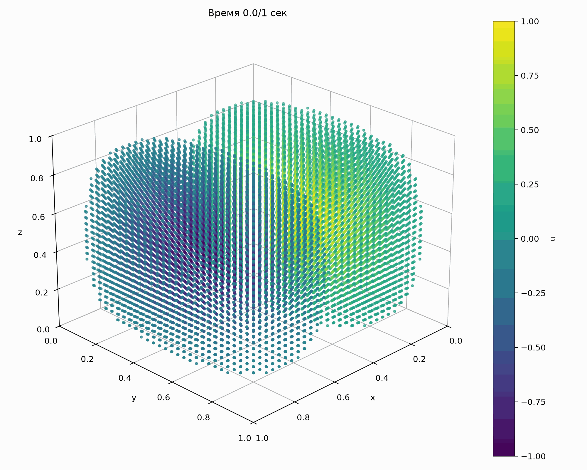

# edu-cmc-skmodel26

Репозиторий для практического задания по курсу "Суперкомпьютерное моделирование и технологии"

[Отчет о выполнении задания](./report/main.pdf)

Сборка и запуск на IBM Polus (версия с OpenMP):
```bash
g++ -o main.out main.cpp -std=c++11 -fopenmp
mpisubmit.pl -t 8 main.out --stdout std.out --stderr std.err -- 128 20 1. 1. 1. 0.01
```

<!-- Сборка и запуск на IBM Polus (версия с MPI + OpenMP):
```bash
mpixlC -o main.out main.cpp -qsmp=omp -std=c++11 -O3
mpisubmit.pl -t 4 -p 4 main.out --stdout std.out --stderr std.err -- 128 20 1. 1. 1. 0.1 -->

Визуализация поведения решения и ошибки для сетки $`L_x=1, L_y=1, L_z=1, T=1`$, со 128 пространственным и 50 временными шагами:



<!--  -->
